# Monster Gate 2: Great Dungeon (GBA) — English Translation

An unofficial English fan-translation project for Konami's *Monster Gate 2: Dai Inaru Dungeon* (*モンスターゲート2 大いなるダンジョン*, 2003, Game Code `A6GJ`) on the Game Boy Advance.

> [!NOTE]
> **Version 1.0.0 (Release):** All 4,543 game strings (1,017 script descriptors), 8×16 & 8×8 fonts, 107 unique Card HUD/List name sprites, the English character naming screen, opening intro slides, level-clear `CARD GET!` graphic, and all UI/menu/banner graphics are translated. If you encounter any bugs, text clipping, or untranslated elements, please report them on the [Issues page](https://github.com/ericmaddox/monster-gate-2-en/issues).

---

## Screenshots

| Title Screen | Character Select | Character Naming |
| :---: | :---: | :---: |
| 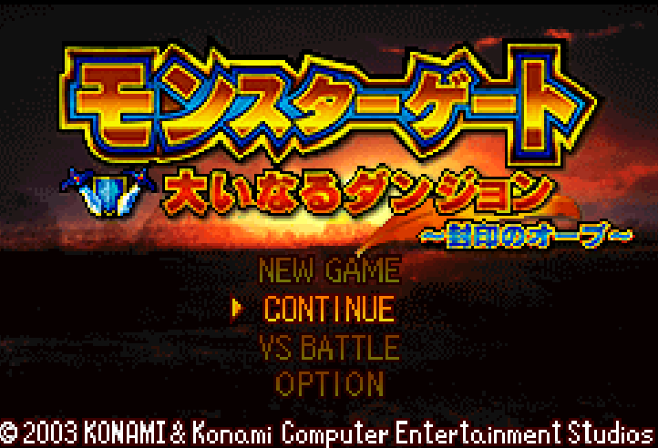 | 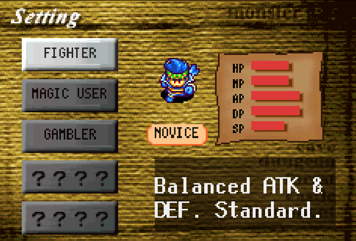 | 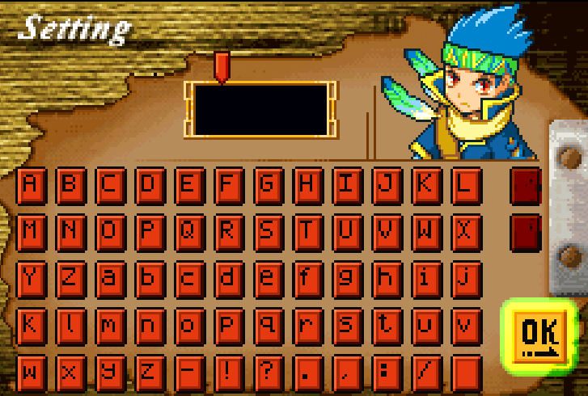 |

| Story Cutscene | Guild Menu | Quest Dialogue |
| :---: | :---: | :---: |
| 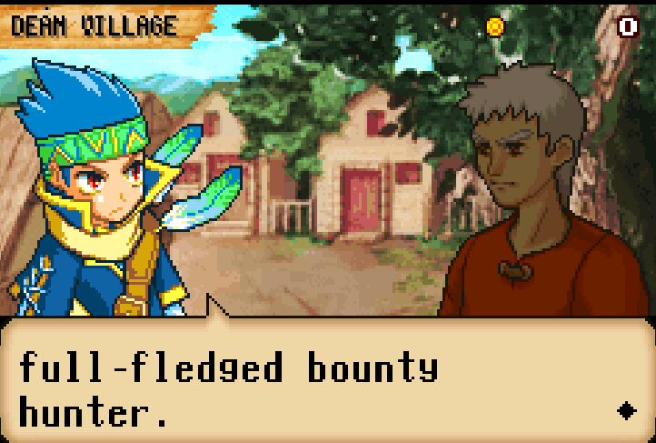 | 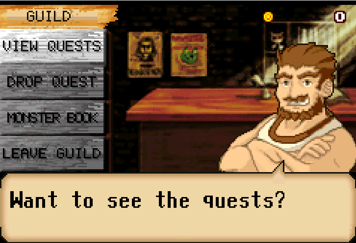 | 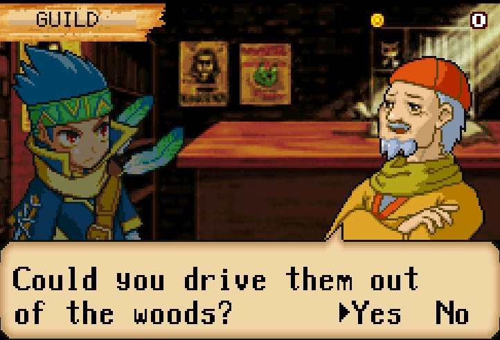 |

| Quest Briefing | World Map | Dungeon Gameplay 1 |
| :---: | :---: | :---: |
| 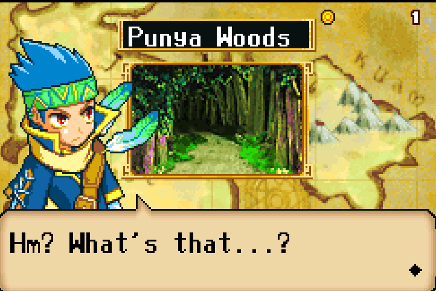 | 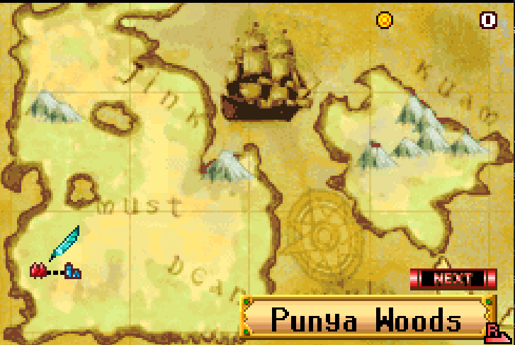 | 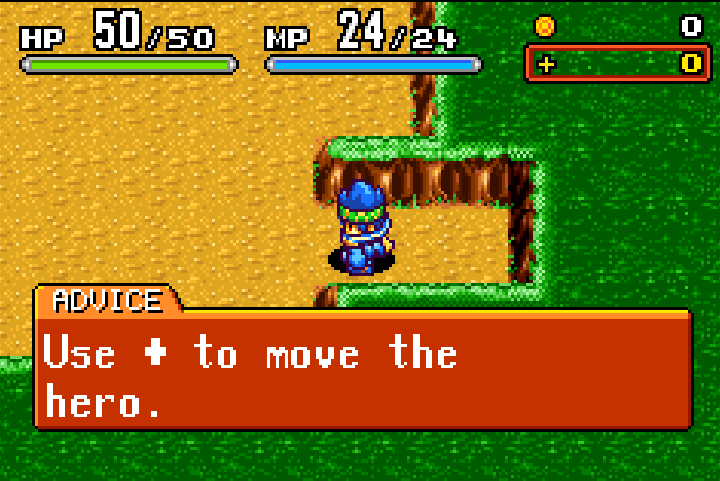 |

| Dungeon Gameplay 2 | Dungeon Gameplay 3 | Dungeon Gameplay 4 |
| :---: | :---: | :---: |
| 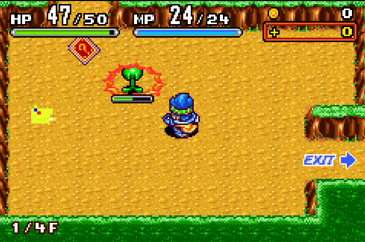 | 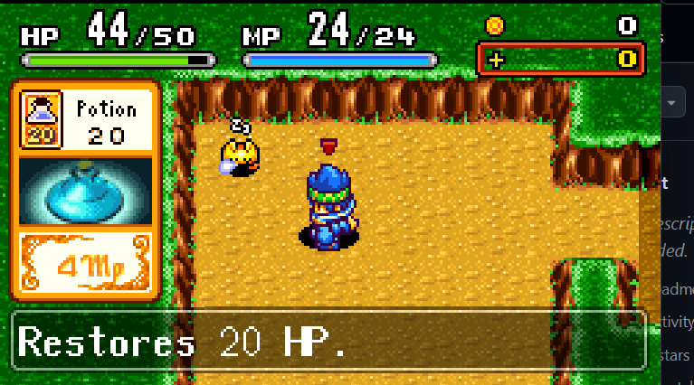 | 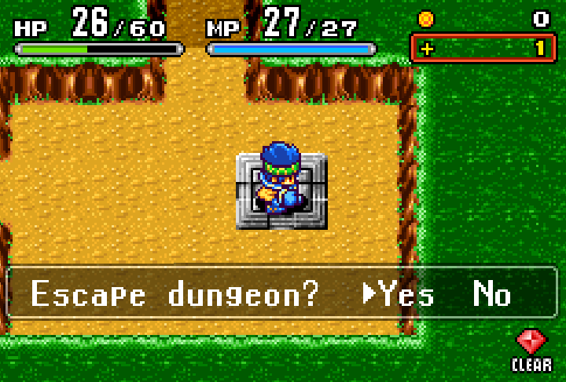 |

---

## ROM Verification

Apply the patch **only** to a clean, unmodified Japanese *Monster Gate 2* (`A6GJ`) GBA ROM matching these exact checksums:

| Property | Clean Japanese Base ROM | Patched English ROM (`v1.0.0`) |
| --- | --- | --- |
| **Game Title / Code** | `MONSTERGATE2` / `A6GJ` | `MONSTERGATE2` / `A6GJ` |
| **File Size** | `8,388,608` bytes (8 MB) | `16,777,216` bytes (16 MB) |
| **CRC32** | `05AC7685` | `E0246534` |
| **MD5** | `2C5221FBCBD75A985D68451CF7FA6C8E` | `179FB03E1FB21F97BA8D4DE874DB25E1` |
| **SHA-1** | `A2C5E2AAC656A953A339ADC22C672BE86DF515FE` | `F61B833CF9C820AB36608381B3DED62DE86211C4` |

---

## Patching Instructions

1. Download the latest release (`v1.0.0`) from [Releases](https://github.com/ericmaddox/monster-gate-2-en/releases) (or extract `patches/monster_gate_2_en_v1.0.zip`).
2. Use [Flips (Floating IPS)](https://www.romhacking.net/utilities/1040/) or [RomPatcher.js](https://www.marcrobledo.com/RomPatcher.js/) to apply **`monster_gate_2_en.bps`** (recommended, includes source/target CRC32 validation) or `monster_gate_2_en.ips` to your clean Japanese ROM.
3. Verify the resulting ROM matches the **Patched English ROM (`v1.0.0`)** checksums above, then load it in an accurate GBA emulator such as [mGBA](https://mgba.io/).

---

## Technical Overview

- **ROM Expansion:** Expanded from 8 MB to 16 MB (`0x08800000`–`0x08FFFFFF`), header checksum updated (`0xBD = 0x59`).
- **Text Engine (`0x800000`–`0x83EC2C`):** All 1,017 script descriptors / 4,543 strings relocated to expanded ROM space with updated local glyph maps (`<= 224` glyphs per descriptor), strict line/box wrapping (`desc 13` Advice boxes, `desc 249` Escape prompt, `desc 8/854..858` Character Select), and full preservation of MG2 control opcodes (`0xF0`, `0xF1`, `0xF3`, `0xF5`, `0xF6`, `0xF7`, `0xF8`, `0xFA`).
- **Font Engine:** Patched 8×16 (`0x385B7C`, 832 glyphs) and 8×8 outlined (`0x39639C`, 832 glyphs) 4bpp fonts with lowercase `a`–`z` and English punctuation, plus custom `MICRO_FONT_3x7` for Card HUD sprites.
- **Character Naming Screen (`0x880000`):** Custom English tile bank (`0x659290`), BG0/BG1 tilemaps (`0x6597B8` / `0x659CB8`), OAM keyboard labels (`0x1C4DF8`), 60-byte keyboard matrix (`0x0F5A38`), and 30 default English player names (`0x0F5AD0`).
- **UI & Card Graphics (`0x890000+` & in-place):**
  - 107 unique Card HUD/List 4bpp name sprites (`0x72CDC0`–`0x72D914`)
  - 6 Opening Intro slides (`0x7254E0`–`0x72551C`)
  - Character Select UI, class buttons & difficulty pills (`0x6BE064`, `0x2B5BD0`, `0x1C98F8`)
  - Mode Menu & Badges (`0x671318`, `0x6C70AC`), Deck Setup BG (`0x66A244`), Data Select (`0x103E58`), Option (`0x102278`), Link (`0x688014`)
  - Dean Village & 11 Town banners/menus (`0x115D48`–`0x118208`), Guild Menu & Quest headers (`0x126FF4`, `0x1278B8`), Card Categories (`0x125CAC`), Monster Book (`0x1868F8`), Shop (`0x0F5128`)
  - Dungeon Pause (`0x3A3E6C`), Dungeon `ADVICE` tab (`0x0E113C`), widened Advice boxes (`0x046386`–`0x046E32`), level-clear `CARD GET!` sprite (`0x2A7124`–`0x2A7924`), and `Yes/No` cursor spacing (`0x01CFE0`, `0x04DFC8`, `0x0781F4`, `0x089DAE`).

---

## Repository Contents

- `patches/monster_gate_2_en_v1.0.zip` — Release archive containing `.bps` and `.ips` patches
- `images/` — Showcase screenshots of the English translation
- `text/` — Raw Japanese text dump (`raw_dump.json`) and categorized English translations (`01_items_cards.json`, `02_monsters.json`, `03_dialogue.json`, `04_system_ui.json`, `all_strings.json`)
- `font/` — Extracted/patched 8×16 and 8×8 font binaries, glyph tables, and contact sheet
- `graphics/` — Generated English naming-screen tile bank (`keyboard_tiles.bin`)
- `release_notes.md` — Release changelog and technical notes

---

## Legal Disclaimer

This repository contains **no** copyrighted game data or ROM files. You must supply your own legally obtained Japanese *Monster Gate 2* ROM to apply the patch.
